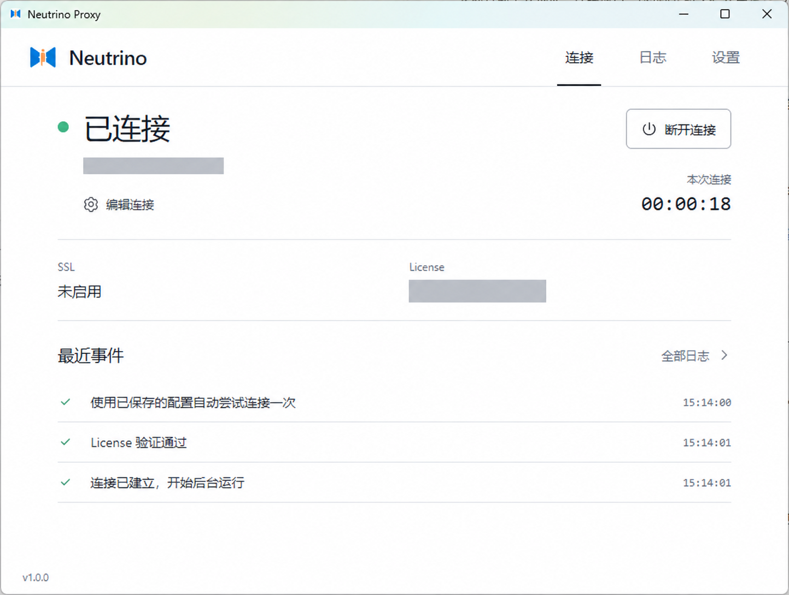
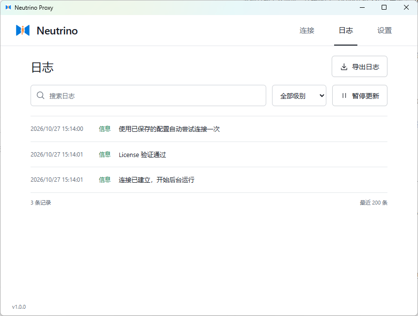
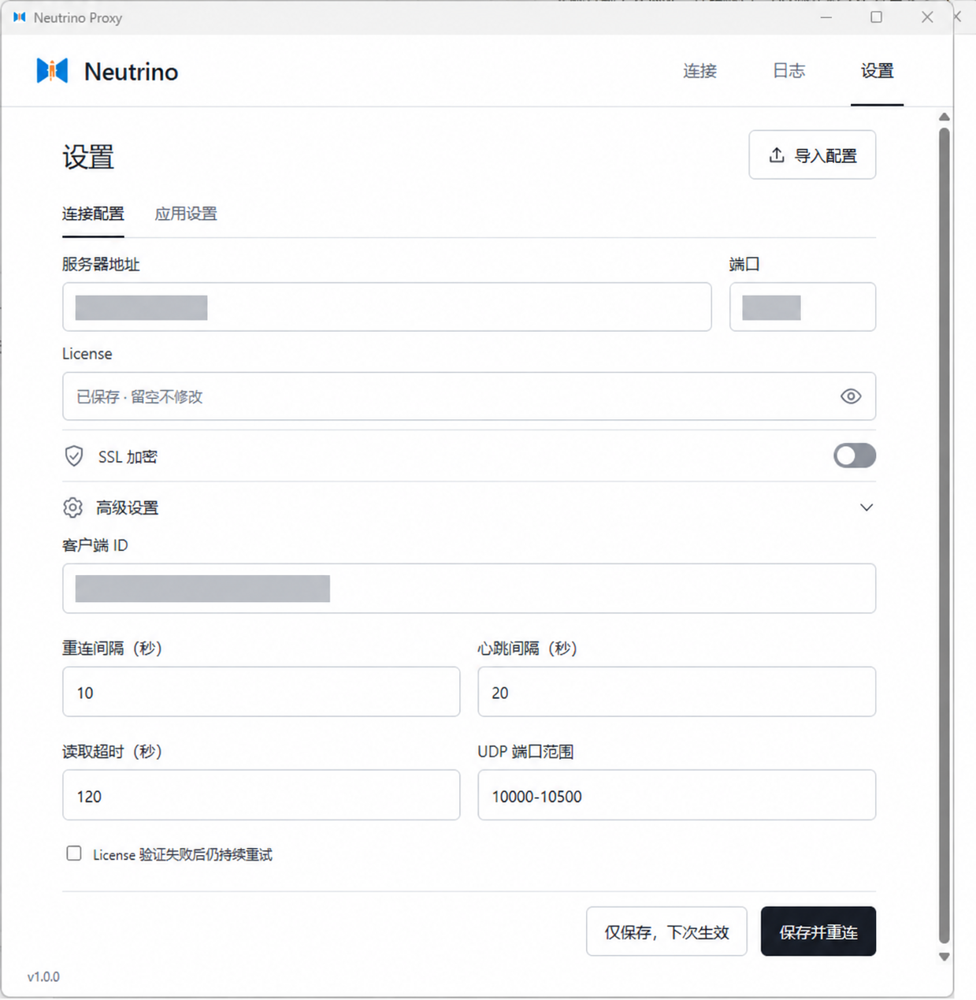
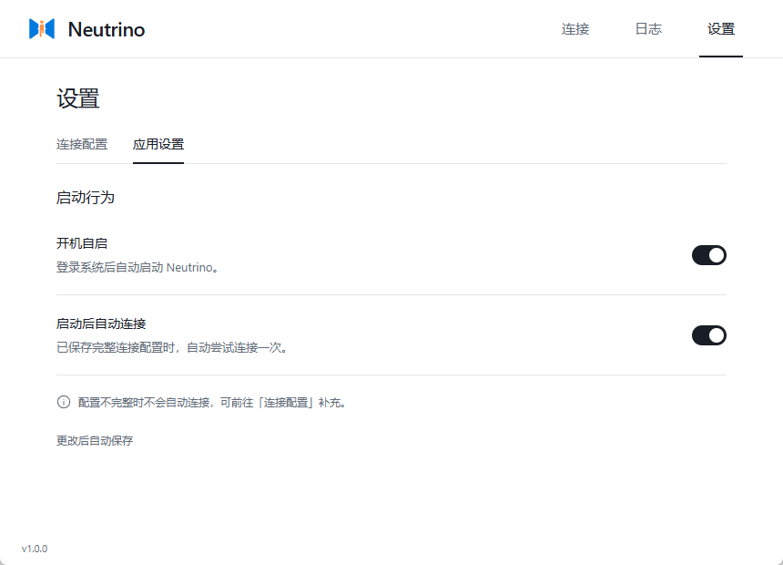
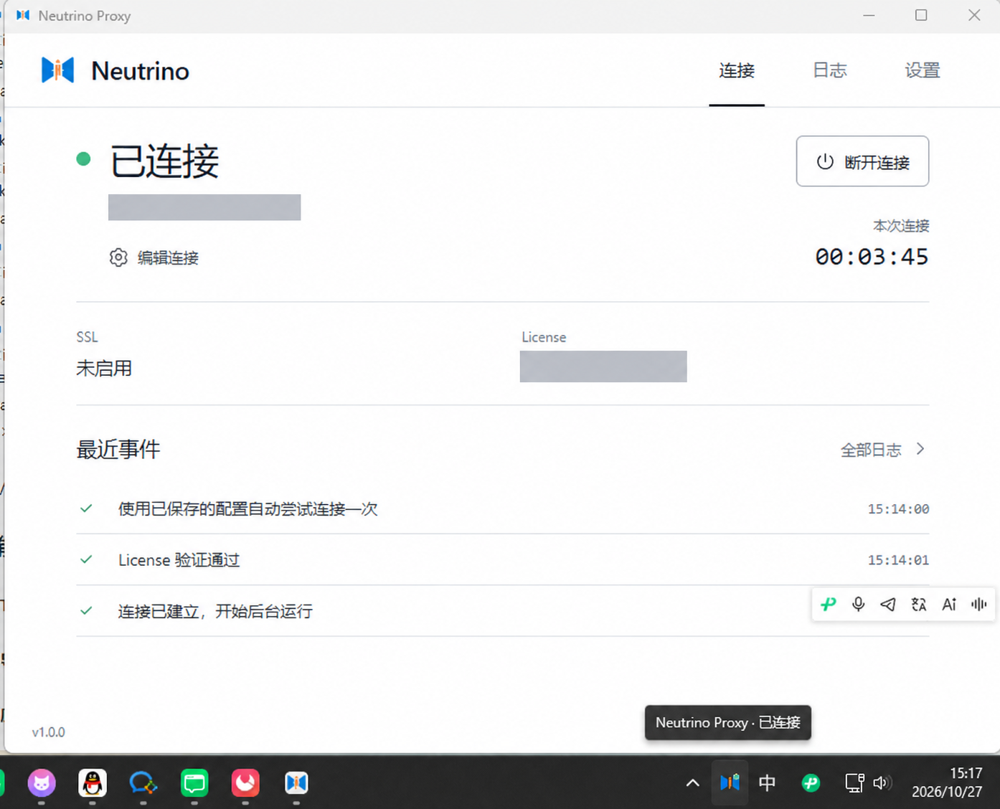
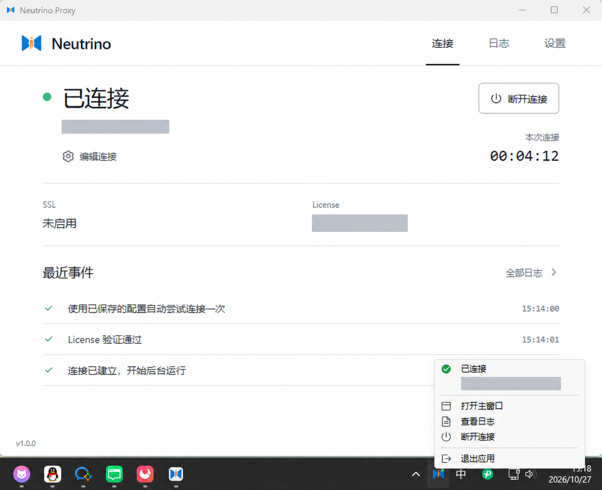

<!-- Logo -->
<p align="center">
  
</p>

<!-- Tagline -->
<h3 align="center">Neutrino Proxy Desktop · Windows / macOS 桌面客户端</h3>

<!-- Badges -->
<p align="center">
  <a href="https://github.com/ynx-official/neutrino-proxy-client-desktop/releases/latest">
    
  </a>
  <a href="https://github.com/ynx-official/neutrino-proxy-client-desktop/actions/workflows/ci.yml">
    
  </a>
  <a href="LICENSE">
    
  </a>
  <a href="https://github.com/ynx-official/neutrino-proxy-client-desktop/stargazers">
    
  </a>
</p>

<br/>

## 功能特性

🔌 **TCP / UDP 转发**，在界面中连接、断开，断线后自动重连

📥 **导入已有配置**，支持 Java 客户端 YAML，预览确认后保存

🧭 **原生系统托盘**，关闭窗口后继续运行，随时恢复主窗口

🚀 **启动设置**，按需开启开机自启和启动后自动连接

📋 **连接日志**，支持搜索、筛选、暂停查看和导出

🔐 **凭证保护**，License 与证书口令保存在系统安全存储中

<br/>

## 🖼 界面预览

以下为 Windows 版 v1.0.0 的界面截图，服务器地址、客户端 ID 和 License 信息已遮盖。

### 🔌 连接状态

查看当前连接状态、本次连接时长、SSL 状态和最近事件；可进入连接配置或断开当前连接。

<p align="center">
  
</p>

### 📋 连接日志

搜索日志、按级别筛选、暂停视图更新或导出日志，便于查看连接、认证和后台运行过程。

<p align="center">
  
</p>

### ⚙️ 连接配置与高级设置

填写服务器地址、连接端口和 License，按服务端要求选择 SSL。展开高级设置后，可调整客户端 ID、重连间隔、心跳间隔、读取超时和 UDP 端口范围；修改后可仅保存，或保存并重连。

<p align="center">
  
</p>

### 🚀 应用设置

开机自启和启动后自动连接可分别开启，更改后自动保存。截图展示两项均已开启的状态，首次使用时两项默认关闭。

<p align="center">
  
</p>

### 🧭 系统托盘图标

应用运行时可在系统托盘中找到图标，鼠标悬停可查看当前连接状态。关闭主窗口后，应用仍可通过托盘访问。

<p align="center">
  
</p>

### 📌 原生托盘菜单

在托盘菜单中查看连接状态与服务器摘要，也可打开主窗口、查看日志、断开连接或退出应用。

<p align="center">
  
</p>

<br/>

## 🌻 为什么使用桌面客户端

将连接配置、运行状态和日志放在同一个窗口中，日常通过托盘管理连接，需要排查问题时打开日志页。

安装后无需单独配置 Java、Node.js 或 Rust 环境。使用前请准备可用的 [Neutrino Proxy 服务端](https://github.com/ynx-official/neutrino-proxy)，以及服务端提供的地址、连接端口和 License。

<br/>

## 📦 下载与安装

前往 **[Releases 下载最新版本](https://github.com/ynx-official/neutrino-proxy-client-desktop/releases/latest)**，按系统选择对应文件：

| 系统 | 下载文件 | 使用方式 |
| --- | --- | --- |
| Windows x64 安装版 | `*-windows-x64-setup.exe` | 双击安装，安装器会按需安装 WebView2 |
| Windows x64 便携版 | `*-windows-x64-portable.zip` | 完整解压后运行 `neutrino-proxy-client-desktop.exe`，需已安装 WebView2 |
| Intel Mac | `*-macos-x64.dmg` | 打开 DMG，将应用拖入 Applications |
| Apple Silicon Mac（M 系列） | `*-macos-arm64.dmg` | 下载 ARM64 版本，打开 DMG 后拖入 Applications |

Windows 版本未签名，macOS 版本未公证。下载后可使用同一版本附件中的 `SHA256SUMS` 核对文件。

<br/>

## ✨ 开始连接

1. 打开应用，进入「设置 → 连接配置」。
2. 填写服务器地址、连接端口和 License；**新配置默认关闭 SSL**，按服务端要求选择是否开启。
3. 点击「保存并连接」，在连接页查看状态。

端口映射在 Neutrino Proxy 服务端管理后台配置。

### 🔌 手动填写连接配置

| 配置项 | 如何填写 |
| --- | --- |
| 服务器地址 | 服务端域名或 IP，不包含 `http://`、`https://` 或路径 |
| 端口 | 服务端提供的客户端连接端口 |
| License | 服务端分配的 License |
| SSL | 与服务端要求保持一致；开启后可使用内置证书或自定义信任证书 |

填写后点击「保存并连接」，等待状态变为「已连接」。

连接后修改配置时，可选择「仅保存，下次生效」保留当前连接，或选择「保存并重连」立即应用。

### 📥 导入已有 YAML 配置

1. 在设置页点击「导入配置」，选择已有的客户端 YAML 文件。
2. 检查预览中的连接参数，确认后保存。
3. 补齐缺少的连接信息，再点击「保存并连接」。

已有配置或导入文件中明确指定的 SSL 开关按原值读取。

<br/>

## 🧭 托盘与后台运行

**关闭主窗口后，应用仍会保持连接并在托盘运行。**

通过托盘菜单可以查看连接状态、打开主窗口或日志。需要完全结束运行时，选择「退出应用」。

<br/>

## 🚀 开机自启与自动连接

进入「设置 → 应用设置」，按需开启：

- **开机自启**：登录系统后自动启动应用。
- **启动后自动连接**：应用启动时，在已保存配置完整的情况下尝试连接。

两项设置默认关闭，修改后自动保存。Windows 便携版移动到新目录后，应关闭再开启一次开机自启，以更新启动路径。

<br/>

## 📋 查看连接日志

进入「日志」页，搜索关键字或按级别筛选；需要仔细查看时可暂停视图，也可导出日志用于排查。

<br/>

## ❓ 常见问题

### 连接失败怎么办？

检查服务器地址、连接端口、License 和 SSL 开关是否与服务端配置一致，再到「日志」页查看具体报错。地址中不要带协议或路径。

### 显示已连接，但访问不到服务？

到服务端管理后台检查端口映射，并确认被映射的本地服务已经启动。

### 更新后打开的还是旧版本？

先从托盘选择「退出应用」，再启动新版本。仅关闭主窗口会保留旧进程。

<br/>

## 💙 反馈与贡献

遇到问题或有建议，欢迎提交 [Issue](https://github.com/ynx-official/neutrino-proxy-client-desktop/issues)。反馈时请附上系统版本、客户端版本和脱敏日志。

欢迎通过 [Pull Request](https://github.com/ynx-official/neutrino-proxy-client-desktop/pulls) 参与改进。

<br/>

## 💖 支持项目

如果这个项目对你有帮助，欢迎点一个 ⭐。

<br/>

## 👨‍💻 开发与文档

配置和使用细节见[本地运行与配置](docs/05-operations/client-app-local-development.md)，其他资料见[文档索引](docs/README.md)。

### 从源码运行与构建

技术栈为 Rust + Tauri 2 + Vue 3。开发需要 Node.js 22.12+、Rust stable 和对应平台的构建工具。

```sh
git clone https://github.com/ynx-official/neutrino-proxy-client-desktop.git
cd neutrino-proxy-client-desktop
npm ci
cargo run
```

环境准备和测试命令见[本地开发文档](docs/05-operations/client-app-local-development.md)，安装包构建与版本发布见[发布说明](docs/06-delivery/releasing.md)。

<br/>

## 🍁 许可证

采用 **[MIT License](LICENSE)**，保留本项目及 Neutrino Proxy 上游版权声明。品牌、公开信任库和协议依据来自 Neutrino Proxy，详见[兼容性说明](docs/03-architecture/client-app-java-compatibility.md)。
