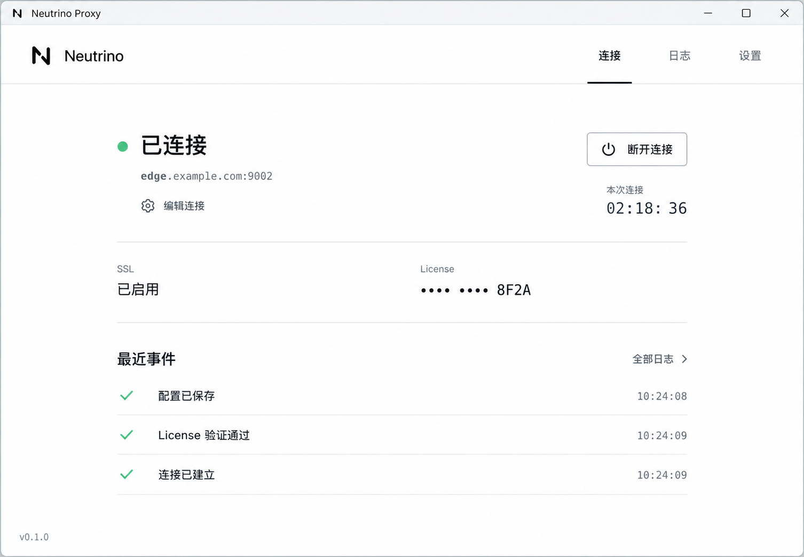
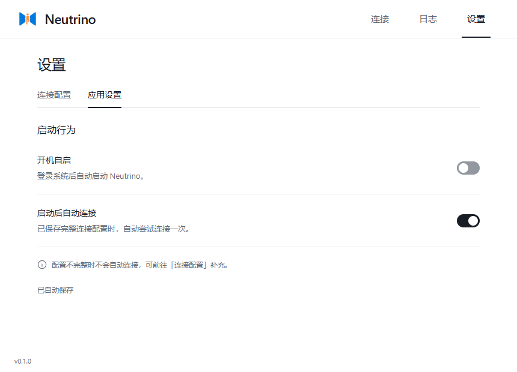

# 桌面客户端界面与交互

状态：Review（本轮视觉样图已由用户确认）
最后更新：2026-10-27

关联文档：[总体方案](../00-project/client-app-proposal.md)、[架构设计](../03-architecture/client-app-architecture.md)、[验证记录](../06-delivery/client-app-development-status.md)、[已替代的色块方案](../99-archive/client-app-ui-color-variant.md)

## 已确认的视觉基线

用户于 2026-10-15 对下图明确回复“就改成这种风格”。本轮据此把连接、设置、日志三页统一为顶部导航、单一白色画布、细线分隔和克制文字的简约界面。

样图由内置 image_gen 在上一轮生成，使用虚构服务器与掩码凭证；原始生成文件复制到本项目，不依赖用户临时目录。其布局与视觉优先于旧色块方案。基础 Skill 仍为 awesome-design-md，Source 为 VoltAgent/awesome-design-md，Style ID 为 airtable；根目录 AGENTS.md 记录已确认的简约适配。

连接协议、配置含义、凭证存储、后台运行和导入规则保持既有实现。本文只规定当前 UI；迁移与后续功能范围见架构及开发进展。

## 公共布局与视觉规范

- 顶部为品牌和“连接 / 日志 / 设置”导航，选中项使用短墨色下划线；移除侧栏和重复状态摘要。底部左侧保留小号版本。
- 内容宽度最大 736 像素，居中排列。默认窗口与最小窗口均为 860 × 620（2026-10-15 按用户要求，将默认尺寸收至原最小尺寸）；保留系统标题栏，主内容独立滚动。
- 页面不使用外层卡片、大面积色块、装饰图形或渐变。各区由留白和细线区分，连接状态由文字及小指示符表达。
- 设置与日志沿用相同的内容宽度、按钮、输入框、边距和字号。全新配置、加载、禁用、错误与未保存反馈保留。

| 角色 | 当前值 |
|---|---|
| 画布 | #ffffff |
| 标题 / 正文 / 次级文字 | #181d26 / #333840 / #626b78 |
| 分隔线 | #e3e6ea |
| 已连接指示点 | #43bd89 |
| 成功事件 / 错误 | #248458 / #aa2d00 |
| 主按钮 | #181d26，白色文字 |
| 焦点 | #458fff，2 像素外框 |
| 输入框及按钮圆角 | 6 像素 |
| 正文 / 页面标题 / 主状态 | 14 / 24 / 32 像素 |

使用 Segoe UI、Microsoft YaHei UI、PingFang SC 和系统字体回退。字重以 400–500 为主；连接时长、地址与事件时间使用系统等宽字体。按钮和输入框至少 44 像素高；SSL 开关通过透明命中区域保持 44 像素操作范围。仅连接中的小图标旋转，系统减少动态效果设置可禁用。

## 连接页

左侧为状态、服务器与端口、“编辑连接”；右侧为连接操作及本次时长。下方依次为 SSL / License 信息行、最近事件，保持样图的单列结构与对齐关系。

- 服务器与端口显示一次，长地址截断后可悬停查看全文。SSL 摘要取当前活动配置；待应用修改保留“新配置将在下次连接时生效”。
- License 始终脱敏。状态、时长与日志来自引擎，不展示虚构的速度、流量、延迟或资源占用。
- 首次连接提供“填写连接信息”“导入配置”；活动连接提供“断开连接”或取消；等待重连保留“立即重试”“停止重连”及真实倒计时。
- 失败和重连原因保持可读，可换行；不恢复常驻托盘教程、认证成功解释或彩色提醒横幅。
- 最近事件仅显示最新三条，消息左对齐、时间右对齐，“全部日志”进入日志页；空记录只显示“暂无事件”。2026-10-15 按用户要求将首页上限从五条调整为三条，日志页的记录与查看范围保持原规则。

## 设置与日志

2026-10-27 用户确认[应用设置样图](assets/client-app-application-settings-approved.png)并授权实现。顶部导航保持不变，设置页增加“连接配置 / 应用设置”二级页签；默认进入连接配置。应用设置使用“启动行为”小标题、两行开关、细分隔线及说明，不增加卡片或保存按钮。两项默认关闭是本轮采用的实现默认值，图中开关状态仅为展示。

- 开机自启：说明“登录系统后自动启动 Neutrino。”，读取系统实际注册及启用状态；更改后回读确认，失败不显示保存成功。
- 启动后自动连接：说明“已保存完整连接配置时，自动尝试连接一次。”，开关自动保存，下一次完整启动进程时生效。配置不足时跳过，提示可前往连接配置补充。
- 加载及保存期间禁用开关；读失败提供重新读取，写失败显示可读错误并重新读取真实状态。修改应用设置不修改连接表单、凭证或当前会话。
- 从有未保存修改的连接配置切换到应用设置时，保留放弃修改确认。连接配置仍提供导入、仅保存与保存并连接；小窗口收紧表单间距，展开高级内容后允许滚动。

上图与[新增页签后的连接配置](../04-quality/assets/client-app-settings-tabs.png)为 860 × 620 Edge 检查截图，使用开发 IPC 替身及虚构信息；不代替原生窗口或系统登录启动实测。启动和持久化规则见[架构说明](../03-architecture/client-app-architecture.md#应用偏好与进程启动2026-10-27)。

设置使用没有外框卡片的连续表单。地址与凭证、SSL 与证书、高级选项由细线分隔；高级设置默认折叠。SSL 关闭隐藏证书区，自定义 JKS 按原规则显示密码输入。

已保存凭证的提示为“已保存 · 留空不修改”，空值提交仍保留原凭证。仅保存与保存并连接 / 重连保持明确区分；活动连接的仅保存按钮标明下次生效。保留字段错误、未保存标记、保存结果与离开确认。展开内容超出小窗口时，操作区保持可达。

2026-10-16 导入确认改为增量合并，支持旧官方 `neutrino.proxy.client` 与新版 `neutrino.proxy.tunnel` 两种连接分组。缺失分组不弹错误，缺失字段沿用已保存内容；预览用逐行列表仅显示本次文件实际识别的字段，License / 证书密码隐藏明文。未读取的本机地址、端口或 License 状态不再出现在预览。首次缺少 License 等必填项也可先导入部分配置，确认保存后进入设置，不自动连接；没有可用字段时禁用应用，仅显示提示。详细规则见[配置迁移](../03-architecture/client-app-architecture.md#4-配置兼容与迁移)。

[导入预览检查截图](../04-quality/assets/client-app-import-legacy.png)：860 × 620 浏览器窗口，虚构配置与开发 IPC 替身，原生导入验证边界见[验证记录](../06-delivery/client-app-development-status.md)。

日志页保留搜索、级别、暂停与导出，以细线列表展示时间、级别、来源和消息；小窗口隐藏次要来源列。暂停只冻结视图，后台继续记录；空筛选可清除，底部显示数量与视图范围。

## 项目 Logo 与桌面图标

2026-10-15 用户指定使用 `assets/logo/logo.png`，并授权加工成适合 Windows / macOS 的软件图标。原始蓝色两翼与橙色主体作为品牌依据，原图文件保持不变。

桌面图标由内置 image_gen 参照原 PNG 制作浅色圆角底座和留白，再由项目现有 Tauri CLI 导出平台格式。此底座版本为本轮实现选型，用户尚未单独确认生成图；不把生成稿写成已批准样式。Style ID 仍为 `airtable`，Logo 配色沿用用户指定的项目品牌。

- `src-tauri/icons/app-icon.png`：1254 × 1254 RGBA 母版；发布流水线以此重新导出平台图标。
- `icon.ico`：16 / 24 / 32 / 48 / 64 / 256 像素，供 Windows 可执行程序及安装包使用。
- `icon.icns`：包含 1024 像素图层的 macOS 容器；已导出并检查格式，未在 macOS 运行验收。
- `icon.png`：512 × 512，供桌面宿主使用；外部区域透明。
- `tray.png`：直接从原 PNG 等比生成 64 × 64 透明图标，不使用底座，避免菜单栏和通知区域的主体过小。宿主预生成绿点 / 灰点两个状态图，不在每次状态更新时重绘。
- 窗口顶部的 `BrandMark` 读取原 Logo 的逐字节副本；托盘原生图标读取透明小图并叠加连接状态点。历史 WebView 浮层曾复用 `BrandMark`，现已退役。

实际浏览器验证截图使用开发 IPC 替身及虚构数据：[连接页品牌](../04-quality/assets/client-app-project-logo-connected.png)、[历史托盘浮层品牌](../04-quality/assets/client-app-project-logo-tray.png)。图标生成提示词见[生成记录](client-app-mockup-prompts.md)，平台验证边界见[开发进展](../06-delivery/client-app-development-status.md)。

## 实现与验收

2026-10-15 简约样式改造复用现有 Vue / Router 与原生接口，当时无新增依赖、未修改 Rust 内核或服务端。浏览器流程校验三项导航处于同一水平行且高于页面内容，并验证三页可用；该用例曾在旧侧栏稳定失败，再由新布局通过。2026-10-27 应用设置新增宿主偏好和系统自启接口，并在内核增加启动单次尝试策略，证据见最新开发记录。

实际测试和 Windows 构建结果见[验证记录](../06-delivery/client-app-development-status.md)。下列是实际 Vue 页面截图，使用 IPC 测试替身与虚构数据，不代表连接真实服务器：

Windows 独立预览已实际打开并检查三页；[原生设置页](../04-quality/assets/client-app-minimal-windows.jpg)使用空配置。为保留用户当前连接，检查后关闭测试预览，日常使用的新版程序保留原应用标识与配置目录。

## 托盘菜单（系统原生）

2026-10-16 用户反馈右击卡顿并要求使用系统原生菜单。原浮层每次打开都新建 WebView、加载 Vue，关闭时销毁；现改用 Tauri 的 Rust 菜单接口，启动时创建菜单，单击和右击直接交给系统弹出。菜单随 Windows / macOS 的字体、主题、选中、禁用、定位和键盘行为显示；这是用户要求的原生交互，不再套用网页的颜色、圆角或尺寸。[Tauri 托盘菜单](https://v2.tauri.app/learn/system-tray/#add-a-menu)

- 2026-10-16 用户确认[精简原生菜单预览](assets/client-app-native-tray-approved.png)：去掉应用名称标题及“状态：”前缀。首行为带小状态图标的“已连接 / 未连接”等状态，点击打开连接页；第二行为禁用的服务器地址。活动连接使用实际会话地址；仅保存的新配置在下一次连接后才改变此处的活动地址。空配置显示“尚未配置服务器”。不显示 License 或日志正文。
- “打开主窗口”恢复当前页面；“查看日志”打开日志页，沿用设置页未保存修改的确认流程。主窗口已销毁时按默认 860 × 620 重建。
- 已连接只显示“断开连接”；未连接或失败显示“连接”；连接中显示“取消连接”，等待重连显示“停止重连”，断开中禁用重复操作。宿主再次检查当前状态，拒绝过时的相反动作。缺少有效配置时“连接”进入设置。
- “退出应用”独立分组，断开并结束程序。菜单仅在服务器摘要后及退出项前放两个分隔线；主窗口、日志、连接操作与退出项使用 16 × 16 透明小图标，来源为已有界面图标路径，启动时解码并缓存。托盘图标使用已连接绿点、其他状态灰点；悬停文字仍显示应用名与具体状态。
- Escape、点击外部与操作完成后的收起交由系统菜单管理。托盘没有独立 HTML、Vue 入口、窗口或 IPC 命令；打开托盘不启动额外 WebView。主窗口关闭后仍由同一个 Rust 引擎工作。
- 只在状态、操作或服务器摘要改变时替换缓存菜单；日志、连接时长及 revision 变化不会触发菜单重建。异步执行窗口和连接操作，拒绝重复激活；失败记录到日志并打开日志页反馈。
- 系统负责多显示器、工作区和 DPI 定位。预览为生图参考，实际字体、行高、主题和弹出效果由系统决定。Windows 已用真实系统菜单句柄校验结构、禁用项及互斥动作；实际点击、右键时延及 macOS 原生表现仍需分别验证，不能把结构测试视为时延测量。

此前用户确认的[浮层样图](assets/client-app-tray-preview.png)与实际 Vue 浮层截图（[已连接](../04-quality/assets/client-app-tray-connected.png)、[未连接](../04-quality/assets/client-app-tray-idle.png)）保留用于追溯，已不代表当前原生菜单外观。原生验证与构建边界见[验证记录](../06-delivery/client-app-development-status.md)。
