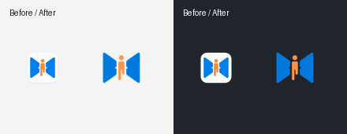

# 桌面与托盘图标

状态：Approved（用户指定复用来源）  
最后更新：2026-10-16  
关联文档：[项目计划](../00-project/desktop-plan.md)、[验证记录](../04-quality/verification.md)

用户要求直接复用 `neutrino-proxy-client-app` 的图标，托盘保留透明背景，避免小尺寸显示成白色块。同日追加要求任务栏与窗口左上角也使用透明版本，现同步更新 Windows 应用资源。

| 使用位置 | 本项目资源 | 来源及处理 |
|---|---|---|
| Windows 托盘 | `assets/tray.ico` | 原 App `src-tauri/icons/tray.png` 转为 16/20/24/32/40/48/64 像素 RGBA ICO；不添加底色 |
| macOS 菜单栏 | `assets/tray.png` | 原 App `src-tauri/icons/tray.png` 逐字节复制，64×64 RGBA |
| Windows 应用、任务栏、标题栏 | `windows/runner/resources/app_icon.ico` | 16/20/24/32/40/48/64 像素与透明托盘图逐像素一致；128/256 像素从原 Logo 等比居中生成，无底色 |
| macOS 应用 | `macos/Runner/Assets.xcassets/AppIcon.appiconset/` | 读取原 App `src-tauri/icons/icon.icns` 的 1024 像素图层，导出目录要求的 PNG 尺寸，保留 alpha |
| 窗口品牌 | `assets/logo.png` | 项目原 Logo，保持原样 |

原来 Flutter 的托盘 ICO 与带浅色底座的应用 ICO 相同，导致通知区域出现白底。先修正托盘，随后按用户追加要求统一 Windows 应用图标；后续不得恢复白色底座。`Runner.rc` 中的 `IDI_APP_ICON` 供 EXE 和窗口类共用，因此重新构建后任务栏与窗口左上角使用同一透明资源。

以下为实际图标文件在浅色和深色背景上的合成对比。每组左侧为修改前，右侧为修改后；不是系统托盘截图。

已核对透明 PNG 与来源逐字节一致，托盘 ICO 七个尺寸、Windows 应用 ICO 九个尺寸均含 0–255 alpha。系统托盘和标题栏在进程启动时加载图标，正在运行的实例需从托盘退出后重新打开，关主窗口只会隐藏，不能刷新图标。
