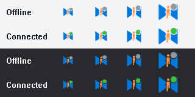

# 桌面与托盘图标

状态：Approved（用户指定复用来源与托盘状态点）
最后更新：2026-10-16  
关联文档：[项目计划](../00-project/desktop-plan.md)、[验证记录](../04-quality/verification.md)

用户要求直接复用 `neutrino-proxy-client-app` 的图标，托盘保留透明背景，避免小尺寸显示成白色块。同日追加要求任务栏与窗口左上角也使用透明版本，现同步更新 Windows 应用资源。

| 使用位置 | 本项目资源 | 来源及处理 |
|---|---|---|
| Windows 托盘 | 宿主内嵌的 `windows/runner/resources/app_icon.ico` 32 像素图层 | 与 `assets/tray.ico` 的透明图层一致；原生宿主运行时在右上角叠加状态点，原始文件保持不变 |
| macOS 菜单栏 | `assets/tray.png` → bundle 的 `neutrino-tray.png` | 原 App `src-tauri/icons/tray.png` 逐字节复制，64×64 RGBA；原生宿主按 18 点尺寸叠加状态点 |
| Windows 应用、任务栏、标题栏 | `windows/runner/resources/app_icon.ico` | 16/20/24/32/40/48/64 像素与透明托盘图逐像素一致；128/256 像素从原 Logo 等比居中生成，无底色 |
| macOS 应用 | `macos/Runner/Assets.xcassets/AppIcon.appiconset/` | 读取原 App `src-tauri/icons/icon.icns` 的 1024 像素图层，导出目录要求的 PNG 尺寸，保留 alpha |
| 窗口品牌 | `assets/logo.png` | 项目原 Logo，保持原样 |

原来 Flutter 的托盘 ICO 与带浅色底座的应用 ICO 相同，导致通知区域出现白底。先修正托盘，随后按用户追加要求统一 Windows 应用图标；后续不得恢复白色底座。`Runner.rc` 中的 `IDI_APP_ICON` 供 EXE 和窗口类共用，因此重新构建后任务栏与窗口左上角使用同一透明资源。

以下为实际图标文件在浅色和深色背景上的合成对比。每组左侧为修改前，右侧为修改后；不是系统托盘截图。

已核对透明 PNG 与来源逐字节一致，托盘 ICO 七个尺寸、Windows 应用 ICO 九个尺寸均含 0–255 alpha。升级托盘实现后，正在运行的实例需从托盘退出后重新打开。当前独立进程架构中，关闭主窗口会释放 Flutter 界面，原生宿主及网络内核继续运行，不会重载宿主图标代码。

## 托盘状态点

2026-10-16 用户明确要求：连接成功时，托盘图标右上角显示绿点；其余情况显示灰点。状态来自 Dart 内核的 `engine.state`，不依赖 Flutter 窗口是否存在。

| 内核状态 | 颜色 |
|---|---|
| `connected` | 绿色 `#39bf45` |
| 启动、`idle`、`connecting`、`authenticating`、`reconnecting`、`error`、其他状态 | 灰色 `#9297a0` |

颜色使用既定 Airtable 风格的 success-border / border-strong；圆点直径为图标边长的 32%，外围留透明间隔，避免与 Logo 混在一起。仅宿主托盘/菜单栏显示状态点，应用、窗口、任务栏图标保留原样。两种状态图标缓存复用，不新增后台定时器或 Flutter 进程。

以下为生产 HICON 使用 Windows `DrawIconEx` 在浅色与深色背景上的绘制预览，每行依次为 16/20/24/32 像素；不是系统托盘截图：

Windows 验证：先运行回归测试确认旧代码缺少绿点而失败；修改后，启动灰点、连接绿点、其他状态灰点、内核退出转灰、状态反复切换复用图标、GDI/USER 句柄无增长，以及圆点区域外 Logo/透明度逐像素不变均通过。测试目标为 `neutrino_tray_test`，已加入 Windows 构建工作流；macOS 已同步实现，尚未在 macOS 编译或运行。

本次 Windows Release 构建、`actionlint` 和 `git diff --check` 通过。隔离配置下执行 `verify-background.py --cycles 0 --samples 5 --scenario tls-idle`，本地 TLS 认证成功 1 次；这只是短时启动与连接检查，不替代后台长期稳定性验收。
