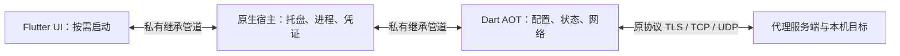

# 独立 Dart 内核与可退出界面

状态：Review（Flutter + Dart 路线已获用户批准；平台验收分别记录）  
最后更新：2026-10-16  
关联文档：[实施状态](../06-delivery/background-process-plan.md)、[验证记录](../04-quality/background-process-verification.md)、[协议依据](protocol-and-architecture.md)、[历史提案](../99-archive/background-process-proposal.md)

## 已确认范围

2026-10-16 用户明确要求“Flutter + Dart 继续重构方案吧，做完再对比”。沿用 Flutter 界面和纯 Dart 网络实现，收起时结束界面进程，保留后台连接。未切换 Rust，也未授权本轮实现 Android。C++/Swift 仅承担平台集成，不实现网络协议。

Java 客户端和 core 仍是网络协议权威来源；已有 Tauri App 仅为视觉及交互参考。服务器、管理后台、开机自启和自动连接策略不变。窗口关闭前保留未保存草稿确认；普通最小化仍保留界面进程。

## 实际进程与代码边界

后台为宿主和 worker 两个应用进程，前台增加一个 Flutter UI。性能必须统计整个进程树；没有调用工作集裁剪或定时强制 GC。

| 目录 | 职责 |
| --- | --- |
| `lib/core/` | 既有纯 Dart 协议、TLS、取消、重连与 TCP/UDP 转发 |
| `lib/background/` | 帧编解码、UI IPC 客户端、配置与引擎服务、worker 调度 |
| `services/proxy_worker/` | 独立依赖图与 AOT 入口；不依赖 Flutter SDK/插件 |
| `lib/application/` | 配置事务、Riverpod 状态投影；旧 isolate bridge 保留作回归对照，不用于生产入口 |
| `lib/platform/` | Flutter 窗口激活、草稿确认和 UI 退出 |
| `native/host_windows/` | Win32 托盘、进程/Job Object、DPAPI |
| `native/host_macos/` | AppKit 状态栏、Process/Pipe、Keychain；待 macOS 实机验证 |

本轮直接共享既有纯 Dart 源码，没有为单一消费者拆出多个发布包。这是对原提案目录安排的简化，依赖隔离由 worker 自己的 pubspec/lockfile 和独立 AOT 编译验证。Flutter 3.47.5 / Dart 3.13.4 保持原锁定版本。

## 生命周期

| 操作或故障 | 行为 |
| --- | --- |
| 打开应用 | 宿主单实例，启动唯一 worker，再打开 UI；不自动连接 |
| 关闭主窗口 | 确认草稿，等待进行中的保存；发送 detach，结束 Flutter 进程；连接继续 |
| 系统最小化 | 保留 UI；需要释放 UI 时使用关闭按钮 |
| 托盘打开/日志 | 启动或激活 UI，重新 attach，恢复当前配置、连接时长、日志 |
| 托盘连接/断开 | 直接控制 worker，不启动 UI |
| UI 崩溃 | 宿主清理订阅；worker 继续运行 |
| worker 崩溃 | 当前隧道中断；5 分钟内最多重启 3 次，退避 1/3/10 秒；保留明确连接意图后重连 |
| 超出重启预算 | 保留托盘，用户可手动连接重试 |
| 宿主崩溃 | Windows Job Object 结束其子进程；worker 也处理父管道 EOF，关闭网络并退出 |
| 退出应用 | 宿主专用 shutdown，等待回应/进程退出，5 秒兜底；只处理自己启动的子进程 |

已保存配置只在下一次连接生效；重连按钮除外。UI 不读取已有凭证明文，保存时 null 表示保留原值、空字符串表示清空。新建 UI 恢复当前状态，不恢复未保存敏感草稿；窗口位置暂未额外持久化。

## IPC 契约及资源上限

父子 stdin/stdout 专用于 IPC，不开本机管理 TCP 端口。Windows 用受限继承句柄列表；启动子进程不创建控制台。子进程 stderr 当前定向到空设备，避免协议被普通输出污染；故障以宿主状态及退出事件呈现。

- 帧：4 字节大端长度 + UTF-8 JSON 对象；单帧上限 8 MiB，输入不完整、非法 JSON/UTF-8 或越界时失败。
- 请求：`kind=request`、`version=1`、`id`、`op`、`params`；宿主补 `source` 和 UI `session`。
- 操作：attach、detach、snapshot、connect、disconnect、save、shutdown。shutdown 仅接受宿主来源。
- 快照：worker `epoch`、状态 `revision`、独立的 `configRevision`、配置、连接状态和有界脱敏日志。
- 保存带预期 configRevision；同会话最近 32 个请求缓存响应，重复 id 不重复执行。UI 请求超时不自动重放变更。
- 每方向发送队列上限 16 MiB；worker 待执行请求上限 64 个/16 MiB。凭证响应独立分发，避免串行命令等待 vault 时死锁。
- 证书原文件上限 4 MiB，由 UI 读取后 base64 传入；内核写入哈希命名副本。没有实现原提案的小块上传，选择单个有界传输以减少状态复杂度；导入瞬时内存需单独看待。
- 日志仍最多 500 条，50 ms 合并状态通知；无 UI 时不发送日志，宿主清除自己的日志副本。首版采用有界全量日志快照，未实现增量拉取。
- 网络载荷始终直接经过 worker，与 UI 和宿主无关。

同步流转换器使 UI 取消读取不必等待下一帧。对应回归测试覆盖宿主静默时 detach 能完成，避免仅隐藏窗口却迟迟不结束进程。

## 配置和安全存储

worker 唯一写普通配置，保留 ConfigStore 的“写新凭证 → 原子替换配置 → 清理旧凭证”顺序。保存失败不得删除仍被引用的凭证；系统存储不可读时不降级明文。

Windows 保留 `%APPDATA%/cn.neutrino/Neutrino`、`neutrino-flutter/config.json`、`flutter_secure_storage.dat` 和 `neutrino.flutter.*` 键。宿主兼容当前 flutter_secure_storage_windows 4.2.2 的 DPAPI 加密 JSON 格式；未实现该插件历史 C++ 存储分支的迁移。合成数据验证，不读取或改写 Java/Tauri 客户端配置。

macOS 保留 bundle ID `cn.neutrino.neutrinoProxyClientDesktop`，Application Support 下同名目录，以及普通登录 Keychain 的 `flutter_secure_storage_service` / `neutrino.flutter.*`。不设置 Data Protection Keychain，不新增共享组。签名身份对历史条目的访问仍须实机验证；不能绕过系统提示。

只有宿主处理 vault 消息；UI 不能指定任意系统凭证键。Windows 单实例锁沿用旧名，提示先退出仍运行的旧 Flutter 版。私有管道不宣称能隔离同一用户下的恶意进程。

## 构建与平台状态

Windows CMake 同时构建宿主、Dart AOT worker 与 Flutter UI。原 EXE 名称保留为入口，非 hosted 模式转交宿主后退出；快捷方式无需改名。运行目录必须同时包含三个 EXE、Flutter DLL 和资源。

macOS 先 Flutter build，再执行 `scripts/build-macos-host.sh`：将 Flutter 程序作为 `neutrino_ui`，原 App 入口替换为不链接 Flutter 的 Swift 宿主。宿主使用原有沙盒权限，helper 使用 app-sandbox + inherit；UI 读证书内容后传递，不依赖文件选择器权限能自动传给 worker。[Apple 沙盒继承](https://developer.apple.com/library/archive/documentation/Miscellaneous/Reference/EntitlementKeyReference/Chapters/EnablingAppSandbox.html)

macOS 发布包包含两个独立架构的 Dart worker，由各自架构的 CI runner 编译，宿主按自身架构选择；不直接将 Dart AOT 可执行程序 lipo 合并。宿主、Flutter UI 与框架仍需双架构，helper 分别签名后签整个 App。[Dart 独立可执行程序](https://dart.dev/tools/dart-compile)

Windows 的实际执行证据和 macOS 未验证项分别列在[验证记录](../04-quality/background-process-verification.md)。本机不能构建、签名或运行 macOS，不能将源码已补齐描述为平台验收完成。

持续 UDP 采样还定位并修复了旧取消机制的回调累积：每个已完成操作立即解除取消注册，不等到整个连接断开。相关回归覆盖 10,000 次操作、未完成操作取消与迟到异常；没有更改 Java 兼容的网络帧或认证规则。

## 性能目标与尚未验收的项目

已批准的方向是显著降低后台占用，不承诺任何负载都低于 10 MiB。原提案的建议门槛保留：Windows 空闲背景私有工作集合计中位数 ≤30 MiB/P95 ≤35 MiB；同场景较旧版下降 ≥50%。未连接、TLS 空闲、持续转发分开报告。

50 次真实窗口开关、恢复 P95 ≤2 秒，以及 8 小时稳定性均是待完成的扩展验收，不能用单元测试、少量开关或 30 分钟采样替代。当前用户打断的反复弹窗测试不计为通过；后续自动测试必须提前说明可见影响。
