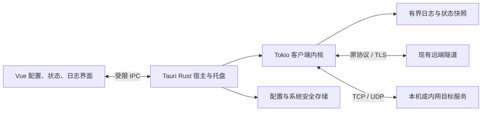
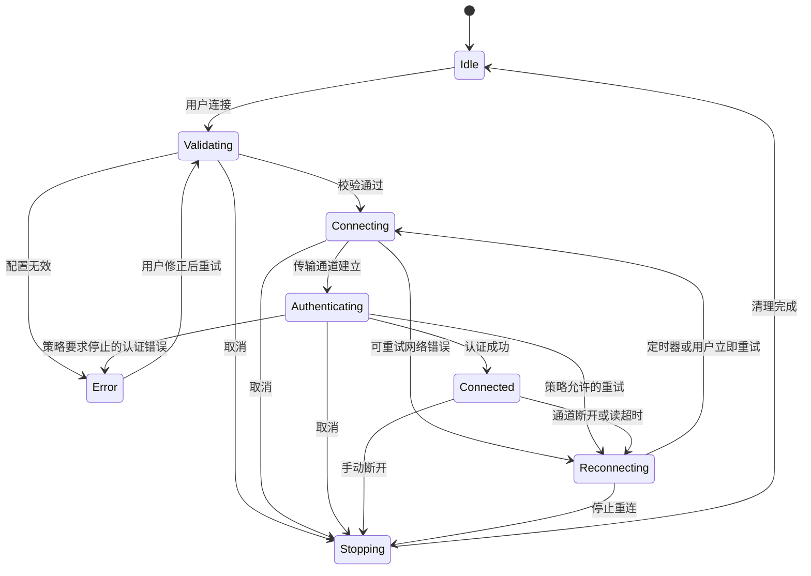

# 桌面客户端架构与兼容性设计

状态：Review
最后更新：2026-10-27

关联文档：[总体方案](../00-project/client-app-proposal.md)、[界面设计](../02-design/client-app-ui.md)、[验收方案](../04-quality/client-app-acceptance.md)、[实施计划](../06-delivery/client-app-implementation-plan.md)

## 1. 架构边界

采用一个桌面产品、一个 Rust 通信内核。Rust 内核作为库供 Tauri 宿主调用，可以在无界面测试中独立启动；不增加本地 HTTP 服务、不启动 Java 子进程。Vue 通过 Tauri IPC 调用有限的命令，不参与实际数据转发。



图中的远端仅表达现有通信边界，不提出服务端改造。

| 单元 | 职责 | 不应承担的职责 |
|---|---|---|
| protocol | 增量编解码、字段校验、消息类型与测试向量 | 窗口和文件权限 |
| session | 认证、心跳、重连、停止与会话状态 | Vue 状态管理 |
| tcp / udp | 转发、背压、映射与资源回收 | 保存凭证、弹窗 |
| config | 旧格式导入、校验、版本迁移、脱敏摘要 | 直接发起网络连接 |
| desktop host | 托盘、窗口生命周期、配置持久化、IPC 权限 | 转发业务载荷至前端 |
| UI | 表单、状态展示、有限日志视图 | 自行认证、循环重连、持久化凭证 |

工程按以下结构实施；本文件定义完整设计目标，当前实现与验证覆盖以[开发进展](../06-delivery/client-app-development-status.md)为准：

```text

  package.json
  src/
    main.js
    router/index.js
    views/                 # Connection、Logs、Settings、NotFound
    components/
    services/desktop.js    # 唯一 IPC 适配层，支持 UI 测试替身
    styles/
  src-tauri/
    Cargo.toml
    tauri.conf.json
    capabilities/
    src/                   # commands、tray、window、storage
  crates/client-core/
    Cargo.toml
    src/                   # protocol、session、tcp、udp、config
    tests/
  tests/                   # UI 流程与桌面验收辅助
```

使用 Vue 3、JavaScript、Vue Router 4 和 Vite 8。当前 Vite 官方说明要求 Node 20.19+ 或 22.12+，部分模板可能要求更高版本；初始化时锁定兼容的 Node 和依赖版本并执行构建，不把满足版本要求等同于构建已通过。[Vite 环境要求](https://vite.dev/guide/)

Tauri 2、Tokio、TLS 及配置库的具体版本在兼容验证后锁定。首版不引入数据库、网络管理 API 或额外服务进程。

## 2. 现有协议事实

以下来自当前仓库，只定义客户端兼容目标。

| 字段 | 大小 | 含义 |
|---|---|---|
| body length | 4 字节 | 大端整数，不包括自身 4 字节 |
| type | 1 字节 | 消息类型 |
| serial number | 8 字节 | 大端序号，按原消息规则生成与透传 |
| info length | 4 字节 | 后续 info 的字节长度 |
| info | 可变 | 字符串或 JSON 元数据 |
| data | 可变 | 剩余业务字节 |

原实现使用 Java 默认字符串编码。新实现以 UTF-8 建立测试基线，同时用旧客户端生成的中文与非 ASCII 样本确认互通；不得以字符数量代替字节长度。默认最大帧配置为 2,097,152，测试必须明确包含长度字段时的边界，不能只测试恰好小于上限的普通包。

当前枚举包含心跳 `0x01`、认证 `0x02`、TCP 连接 `0x03`、断开 `0x04`、转发 `0x05`、错误 `0x06`、端口映射同步 `0x07`、UDP 连接 `0x08`、UDP 断开 `0x09` 和 UDP 转发 `0x10`。枚举存在不等于现有客户端处理了所有类型；逐项对照注册处理器和真实样本确定行为，不擅自扩展管理功能。

认证请求 info 为 `licenseKey,clientId`。认证结果 info 为包含 `code`、`msg` 等字段的 JSON；保留错误码语义并容忍兼容范围内的附加字段。TCP 连接关联使用 `visitorId`，绑定数据隧道时使用 `visitorId@licenseKey`；这些分隔符与字段位置必须逐字节兼容。

UDP 元数据包括 `visitorId`、`visitorIp`、`visitorPort`、`serverPort`、`targetIp`、`targetPort`、`proxyResponses`、`proxyTimeoutMs`。UDP 数据经现有帧协议隧道传输，再由本地 UDP socket 投递目标；不改成自行设计的新 UDP 隧道协议。

依据：[编码器](https://github.com/ynx-official/neutrino-proxy/blob/dev/neutrino-proxy-core/src/main/java/org/dromara/neutrinoproxy/core/ProxyMessageEncoder.java)、[解码器](https://github.com/ynx-official/neutrino-proxy/blob/dev/neutrino-proxy-core/src/main/java/org/dromara/neutrinoproxy/core/ProxyMessageDecoder.java)、[消息结构](https://github.com/ynx-official/neutrino-proxy/blob/dev/neutrino-proxy-core/src/main/java/org/dromara/neutrinoproxy/core/ProxyMessage.java)、[消息类型](https://github.com/ynx-official/neutrino-proxy/blob/dev/neutrino-proxy-core/src/main/java/org/dromara/neutrinoproxy/core/ProxyDataTypeEnum.java)。

## 3. 内核设计

### 3.1 协议与数据转发

编解码器支持半包和连续多包，在分配内存前校验 body length、最小头长度、info length 与配置上限；负数、溢出、截断、非法类型或不合法控制消息不得触发无界分配或进程崩溃。既有实现的边界缺陷不作为必须复刻的行为。

对于结构合法但尚无处理器的消息，现有 dispatcher 直接忽略；新实现保持这一兼容行为，并可限频记录脱敏诊断。结构损坏的帧才按协议错误处理，不能因为收到未知类型就擅自终止健康会话。依据：[DefaultDispatcher](https://github.com/ynx-official/neutrino-proxy/blob/dev/neutrino-proxy-core/src/main/java/org/dromara/neutrinoproxy/core/dispatcher/DefaultDispatcher.java)。

TCP 控制通道负责会话指令，数据通道负责实际传输；目标连接和数据隧道绑定完成前不读取过量数据。HTTP/HTTPS 等应用数据作为 TCP 字节流透传，不增加 HTTP 解析代理。每个方向具备有界缓冲；下游变慢时暂停上游读取，恢复后继续。不得创建无界消息队列缓冲整条下载。

隧道池只保存有效、未绑定的连接，池满关闭多余连接，复用前检查连接状态；控制会话结束时统一清理。池上限为内部资源策略，需要通过并发测试确定，不能把连接池大小误当成允许的全部业务并发数。

UDP 保留数据报边界，按原协议字段绑定会话；不同访客与目标的会话隔离。傀儡端口从配置范围分配，记录最后活跃时间与响应次数，达到原语义的结束条件时解除绑定并归还端口；清理任务不在每个会话内另建系统线程。

下列细节来自现有实现，迁移时必须明确保留，不能只做普通 UDP echo 测试：

- 端口范围包含两个端点，首个端口用于不等待响应的发送；剩余端口服务需要回包的会话。旧配置校验要求最大端口大于最小端口。
- `proxyResponses == 0` 或 `proxyTimeoutMs <= 0` 时不建立回包绑定；`proxyResponses == -1` 表示响应次数不限，仍受超时约束。
- 已绑定通道每次再次发送时，将响应计数清零并更新活跃时间；收到响应也更新活跃时间。超时是最后读写后的空闲时间，不是整个会话总时长。
- 可用端口耗尽时，旧实现退化为默认端口发送、不转发回包。兼容版保留该行为，同时发出“UDP 回包端口不足”的本地告警；若改为拒绝请求，属于需另行确认的行为变更。
- 旧扫描器每轮只检查锁定列表第一项，可能延迟后续会话的清理。新实现应遍历到期项或使用到期队列，记录此资源回收修正，不能把延迟清理缺陷当成兼容要求。

依据：[UdpServerUtil](https://github.com/ynx-official/neutrino-proxy/blob/dev/neutrino-proxy-client/src/main/java/org/dromara/neutrinoproxy/client/util/UdpServerUtil.java)、[UdpRealServerHandler](https://github.com/ynx-official/neutrino-proxy/blob/dev/neutrino-proxy-client/src/main/java/org/dromara/neutrinoproxy/client/core/UdpRealServerHandler.java)、[LockChannel](https://github.com/ynx-official/neutrino-proxy/blob/dev/neutrino-proxy-client/src/main/java/org/dromara/neutrinoproxy/client/util/LockChannel.java)。

### 3.2 会话状态与停止



一个 session supervisor 拥有重连定时器和全部子任务。每次连接生成 session generation；过期任务的回调不得覆盖新状态。断开操作触发取消、停止创建连接、关闭控制/数据/目标 socket、回收 UDP 绑定并等待子任务结束，最后发送 Idle。重复连接、断开、退出命令均须幂等。

现有 `unlimited=false` 特别影响认证失败后的停止，不等同于“所有网络错误只尝试一次”。保留错误分类与重连间隔语义；在桌面版中停止内核会话但保留 App，让用户能修正配置。不要另加一层桌面自动重启绕过此设置。依据：[重连服务](https://github.com/ynx-official/neutrino-proxy/blob/dev/neutrino-proxy-client/src/main/java/org/dromara/neutrinoproxy/client/core/ProxyClientService.java)、[认证处理器](https://github.com/ynx-official/neutrino-proxy/blob/dev/neutrino-proxy-client/src/main/java/org/dromara/neutrinoproxy/client/handler/ProxyMessageAuthHandler.java)。

睡眠期间不承诺持续通信；恢复和网络切换后重新验证通道，按同一重连策略恢复。首版不申请防止系统睡眠的权限。

## 4. 配置兼容与迁移

兼容承诺分为“原字段保留”“运行时参数需要映射”“新 App 偏好”三类。基础业务字段保持名称与含义；配置导入先生成候选结果，再由用户确认写入，失败不覆盖原配置。

2026-10-16 范围修订（用户明确要求）：导入改为逐字段增量合并，缺少 `neutrino.proxy.tunnel` 或其他分组不再报错；缺失、空值、类型 / 范围无效和当前未支持的字段跳过，保留本机已保存的对应值与凭证。支持嵌套 YAML 和 Solon 点分键。非空有效字段生成脱敏候选预览，用户确认后保存，不自动连接；首次配置允许先保存部分字段，完整必填校验仍在手动保存 / 连接时执行。无可用字段只给出不可应用的提示，YAML 格式无效、文件不可读和超出大小限制仍返回错误。

同日兼容补充（依据用户提供的配置键结构）：旧版官方连接字段位于 `neutrino.proxy.client`，新版位于 `neutrino.proxy.tunnel`，两者均需识别。逐字段优先使用明确存在的 tunnel 字段；该字段缺失时再读取 client 同名字段。旧版的地址、端口、SSL、License、证书及密码不依赖 tunnel 分组存在。用户提供的真实连接值不写入文档或测试，回归只保留结构并使用虚构数据。

导入结果另附 `importedFields`，记录实际成功读取字段的标准化标识；完整 `config` 是合并后的候选值，不能视为文件原始内容。预览只展示 `importedFields` 中的字段，凭证仅显示已读取标记。未识别到字段时不展示本机地址或凭证状态，避免“本地回填值被当作已导入”的误导。

2026-10-16 曾将未实现的自定义协议参数列为已跳过。2026-10-26 用户明确要求同步七项差异，现已支持水位线、全部长度字段参数及全空闲时间，并迁移所选 YAML 同目录的旧 ID。当前行为及验证边界以[七项逻辑同步](client-app-java-compatibility.md)为准；这条修订替代此前跳过这些字段的策略。


| 旧字段或来源 | 新客户端处理 | 验证重点 |
|---|---|---|
| tunnel.server-ip / server-port | 直接映射 | 域名、IP、端口边界；不自动改端口 |
| tunnel.license-key | 安全存储引用，认证使用原值 | Unicode、空白处理不暗中改变合法值；日志脱敏 |
| tunnel.ssl-enable | 保留开关 | 开启后证书错误不能降级为明文 |
| tunnel.jks-path / key-store-password | 导入 JKS 信任证书并生成内部信任材料；解析库先验证 | 自定义文件、内置证书、密码错误、证书链和兼容算法 |
| tunnel.client-id / 旧身份文件 | 优先显式值，再导入旧身份；新安装才生成 | 重启不改变身份；不读取任务外未选中的目录 |
| reconnection.interval-seconds / unlimited | 保留业务含义 | 网络失败与认证失败分别验证 |
| protocol.read-idle-time / write-idle-time / all-idle-time-seconds | 映射异步超时和心跳调度 | 0 值含义、单位、后台和睡眠恢复 |
| protocol.max-frame-length | 保留最大帧约束 | 边界与长度前缀口径一致 |
| protocol.length-field-* / initial-bytes-to-strip / length-adjustment | 按 Java LengthFieldBasedFrameDecoder 语义导入并应用，发送格式保持固定 | 无效组合保留已存拆包配置；实际 Java 向量覆盖 1/2/3/4/8 字节、调整及剥离 |
| protocol.water-mark | 映射字节缓冲高低水位 | 单位解析、上下限和恢复读取 |
| udp.puppet-port-range | 保留范围 | 端口冲突、耗尽、释放与跨平台绑定 |
| tunnel.thread-count / udp.*-thread-count | 保存原参数，提出 Tokio 调度映射 | 不宣称线程数与 Netty 完全等价；映射属于兼容性审阅项 |
| heartbeat-log-enable / transfer-log-enable | 保留诊断意图，常规日志脱敏 | 原实现可能输出载荷；是否保留显式高级载荷诊断需另审隐私规则 |
| Solon 日志格式等运行时字段 | 显示兼容说明，不直接执行 | 不将框架专用配置误称为已生效 |
| `${NAME:default}` 环境占位 | 受限解析，显示有效值来源 | 缺失必需值阻止连接；界面启动环境可能与 shell 不同 |

普通配置建议保存为带 `schemaVersion` 的本地文件，包含连接参数、证书与凭证引用、兼容字段和 App 偏好；使用原子替换写入，保留一次已知有效版本便于失败恢复。无需数据库。旧 YAML 导入文件保持原样，日志默认导出脱敏信息。

原默认 SSL 为开启、端口 9002、重连间隔 10 秒、认证无限重试关闭、写空闲 20 秒、读空闲 120 秒、UDP 端口范围 10000–10500。以[原 app.yml](https://github.com/ynx-official/neutrino-proxy/blob/dev/neutrino-proxy-client/src/main/resources/app.yml)和[配置类](https://github.com/ynx-official/neutrino-proxy/blob/dev/neutrino-proxy-client/src/main/java/org/dromara/neutrinoproxy/client/config/ProxyConfig.java)为事实依据；迁移不能只覆盖界面可见的四个基础字段。

2026-10-27 用户要求桌面客户端默认关闭 SSL：Rust `ClientConfig::default()` 与前端初始配置同步使用 `false`，首次配置及缺失该字段时生效。已保存配置、导入文件中的显式 `true` / `false` 继续按其值读取，用户可手动开启；端口仍默认 9002，需与服务端实际设置匹配。开启 SSL 后沿用下文的证书信任与握手签名规则。

## 5. TLS 选型的验证门槛

2026-10-26 已完成本轮决策和实现：按用户要求对齐 Java 的无名称验证策略，保持证书信任和握手签名验证；内置 1024 位 RSA JKS 已进行 TLS 1.2/1.3 真实握手回归。完整策略、直接信任证书的有效期语义及算法限制见[七项同步 TLS 决策](client-app-java-compatibility.md#tls-决策与限制)。以下保留原选型的检查依据，不再将名称策略列为待决定事项。

优先验证 `rustls` / `tokio-rustls`；其兼容协议和算法范围应以锁定版本文档为准。若既有测试证书无法使用，先定位是 JKS 格式、信任链、名称校验还是算法差异，再评估实现选择；不提前承诺某库完全兼容。参考：[rustls 官方文档](https://docs.rs/rustls/latest/rustls/)。

当前 Java 代码创建 JKS 信任库后调用 `createSSLEngine()`，所读路径未显式设置 endpoint identification。新的 TLS 客户端如果增加主机名校验，可能拒绝旧客户端接受的证书。这是必须记录和审阅的安全行为差异，不能静默改变，也不能用接受任意证书解决。依据：[ProxyUtil.createSslHandler](https://github.com/ynx-official/neutrino-proxy/blob/dev/neutrino-proxy-client/src/main/java/org/dromara/neutrinoproxy/client/util/ProxyUtil.java)。

兼容验证必须产出：证书样本矩阵、JKS 导入实现可行性、名称验证差异、可支持的协议和签名算法、具体失败文案。若必须改变既有证书使用规则，则提交独立决策记录，用户确认后才能把该范围标为兼容。整个迁移流程不得要求最终用户安装 Java 或手动运行 `keytool`。

## 6. 桌面生命周期与 IPC

主窗口关闭时，由 Rust 管理窗口销毁和防止应用随最后窗口关闭而退出；托盘与内核继续工作。再次打开只创建一个窗口：先建立事件监听并短暂缓冲，再获取包含 revision 的完整快照，丢弃不晚于该快照的缓存事件，按 revision 应用后续事件；发现事件缺口则重新获取快照。状态提交和 revision 更新在 Rust 内保持一致，不能用“先取快照再监听”留下初始化竞态。销毁 UI 不代表所有平台 WebView 辅助进程立即退出，资源释放需实测。[Tauri 窗口 API](https://v2.tauri.app/reference/javascript/api/namespacewebviewwindow/#destroy)、[托盘文档](https://v2.tauri.app/learn/system-tray/)

2026-10-16 托盘修订：用户反馈右击卡顿并要求系统原生菜单，替代 2026-10-15 的按需 WebView 浮层。菜单在启动时构建并绑定到 `TrayIconBuilder`，由 Windows / macOS 直接显示；不再创建 `tray` 窗口，删除对应 HTML、Vue 构建入口、事件 capability 和四个托盘 IPC 命令。状态订阅只向存在的主窗口发送页面事件。

Rust 根据状态、活动地址及允许操作构造脱敏菜单摘要并缓存；日志、连接时长与 revision 不参与菜单比较，避免每个快照都重建。状态或地址改变时替换菜单，图标仅在连接状态跨越已连接边界时切换。菜单项 ID 保留具体 connect / disconnect 意图，宿主执行前再次检查当前状态；拒绝过时相反操作与重复点击，失败写入日志并打开日志页。窗口创建和网络清理在异步任务中执行，避免阻塞原生菜单事件回调。原生菜单采用系统外观、定位和收起行为，不维持隐藏 WebView。

后续精简修订使用原生 `IconMenuItem`：状态行为可点击项，打开连接页；端点为禁用的普通菜单项。动作图标与状态图标是内嵌透明 PNG，启动时一次解码缓存，保留 SVG 源文件；状态更新不进行文件读取或图片解码。去掉重复应用标题，仅保留两个分隔线，完整规则见[界面设计](../02-design/client-app-ui.md#托盘菜单系统原生)。

### 应用偏好与进程启动（2026-10-27）

用户确认设置分类及两个启动开关后新增此范围。两项互相独立，默认关闭；开机自启只负责登录系统时启动 App，是否连接由自动连接开关决定。开关修改立即保存，自动连接行为在下一次进程启动时应用。

- 宿主 `app_settings` 模块在应用配置目录单独写入 `app-settings.json`，内容为 `schemaVersion: 1` 和 `autoConnect`。先写临时文件、同步并替换，成功后更新内存；不重写 `config.json` 或系统凭证。读取损坏 / 未知版本时保留原文件、关闭自动连接并显示错误，修复文件后需重新启动进程。
- 开机自启使用 [Tauri autostart 插件](https://v2.tauri.app/plugin/autostart/)；Windows 为当前用户 Run 启动项，macOS 为默认 LaunchAgent。开启、关闭后读取系统状态，不另存 `autoStart` 布尔值。Windows 适配补全带引号的可执行路径，防止 `auto-launch 0.6` 写入的裸路径在含空格的安装目录中解析错误；同时保留插件对任务管理器启停状态的处理。注册失败反馈错误，不显示成功。
- `get_app_settings` 无输入，输出 `{ autoStart, autoConnect }`；`save_app_settings` 的 `request` 每次只接受一个可选布尔项，拒绝空修改、同时修改两项及未知字段，返回确认后的完整状态。系统及文件操作进入阻塞线程池并由宿主互斥串行处理。前端无任意启动路径或参数输入，不开放插件的额外 WebView 权限。
- 仅 Tauri 进程 `setup` 在连接配置与系统凭证加载完成后读取自动连接开关。读取失败不连接；地址、端口、License（不为空白）及其他连接参数通过已有校验后，由内核 `connect_on_startup` 消费一次启动机会。证书加载失败同样在建立网络会话前停止，保留可读错误。
- 初始连接 / TLS / 认证失败后保持错误状态，不进入重试循环，即使 `unlimited=true`。成功认证后恢复既有断线重连策略；手动连接完全沿用原策略。启动机会与手动连接 / 断开共享互斥锁，迟到的启动任务不能覆盖用户停止操作。
- 配置不足时跳过并消费本次机会；后续补全、导入配置、切换页签、开关设置、托盘恢复窗口及第二实例唤起均不额外触发启动连接。自动连接不在 Vue 挂载钩子中执行。

Windows 启动项测试使用唯一测试名称注册、回读、禁用并清除测试数据，不改动用户的 Neutrino 启动设置。浏览器截图和注册表测试不能证明系统重启后的登录启动或 macOS 实机行为，验证范围见[开发记录](../06-delivery/client-app-development-status.md)。

### 开发启动与前端进程生命周期

`cargo run` 在生成 Tauri 上下文后、打开窗口前检查本机 HTTP 开发地址。已有服务必须返回本项目 Vite 响应标记才会复用；其他服务占用端口时明确报错，不接管或结束该进程。没有服务时通过 Node 启动项目的 Vite 脚本，等待就绪信号和 HTTP 检查通过，再创建桌面应用。缺少依赖时提示执行 `npm ci`，不自动安装。

Rust 只持有自己启动的子进程。正常退出在 Tauri `run_return` 后清理；独占 stdin 管道的 EOF 使 Node 在父进程被终止时也能关闭 Vite。复用的外部开发服务不随桌面退出停止。关闭主窗口仍为托盘运行，开发服务继续存活，供重建主窗口使用。此模块仅在 Tauri `cfg(dev)` 下编译，生产构建不启动 Node 或 Vite，仍加载内嵌前端；`npm run desktop:dev` 的既有前置命令继续有效。

主窗口导航仍以待消费路径和通知配合：已存在的页面通过 Router guard 确认未保存修改，新建页面挂载后消费路径，避免初始化时丢失导航。菜单无效配置的连接动作进入设置，退出仍先断开再结束进程。原浮层实现与历史验证记录见[开发进展](../06-delivery/client-app-development-status.md)。

建议 IPC 合约：

| 命令 | 输入 | 输出 / 效果 |
|---|---|---|
| get_snapshot | 无 | 脱敏配置摘要、会话状态、revision |
| validate_config | 待保存配置 | 字段错误与兼容提示，不发起连接 |
| save_config | 配置、凭证变更操作、预期配置版本 | 新版本或冲突；默认下次连接生效 |
| connect | 预期配置版本 | 接受结果；完整进展通过状态事件通知 |
| disconnect | 当前会话标识 | 幂等停止，取消重连 |
| reconnect | 当前会话标识、目标配置版本 | 清理旧会话后启动新会话 |
| import_legacy_config | 文件选择产生的句柄 | 脱敏候选配置和兼容报告，不直接覆盖 |
| read_logs / export_logs | 游标、筛选 / 用户选定目标 | 有界脱敏日志 |

凭证更新区分“保持现有值”“替换”“删除”，不能以空字符串或掩码推断用户意图。错误返回稳定错误码、阶段、可重试性和脱敏上下文。前端只使用状态事件，不监听转发数据包；日志和可选计数事件批量限速，无窗口订阅时停止 UI 推送。

所有命令都在 Rust 校验输入和当前状态。只向本地打包页面授予必要 capability；不授予任意 shell、任意路径读写或远程页面 IPC 权限。[Tauri capabilities](https://v2.tauri.app/security/capabilities/)

## 7. 低内存与长期运行策略

- 异步运行时共享工作线程，不照搬 Netty 多组线程池数量；阻塞文件或证书操作离开转发热路径。
- 数据缓冲、写队列、空闲隧道池、UDP 绑定、待处理事件都有上限；保留连接级公平性与取消能力。
- 控制面保留必要状态，不缓存完整业务请求或响应，不把每个包复制给 JavaScript。
- 日志建议内存环形缓冲最多 2,000 条且总计不超过 4 MiB，单条最多 4 KiB；落盘单文件 10 MiB、最多 5 个文件，满额滚动。日志消费慢时丢弃可丢的调试事件并累计计数，不阻塞转发。
- 窗口关闭后释放 DOM、WebView 和相关订阅；窗口重建不重新创建网络引擎。
- 时间测量和 UDP 过期用单调时钟，避免系统时间调整破坏超时判断。

这些是设计约束，实际线程数、缓冲预算、并发容量与内存占用须通过测试确定。暂不承诺“只占几十 MB”；性能测量口径见验收方案。

## 8. 本地数据与安全边界（建议，待审阅）

| 资产 / 边界 | 规则 |
|---|---|
| License、证书库密码 | 使用系统安全存储；前端只在输入和提交时短暂持有，不放入 localStorage 或事件 |
| 普通配置 | 保存应用专用目录，字段校验、版本迁移和原子写入；不自动上传 |
| 证书导入 | 只读取用户选中的文件和明确关联资源；限制大小与解析复杂度 |
| 未受信任的远端帧 | 校验所有长度、消息字段和状态，拒绝越界及异常分配 |
| 日志与导出 | 默认隐藏凭证、密码和载荷；导出前显示目的地和范围 |
| 本地界面 | 仅载入打包资源、限制 CSP、禁用任意命令执行；外部链接不进入有 IPC 权限的 WebView |
| 系统安全存储不可用 | 清楚报错并允许不保存凭证的一次连接，不静默降级为明文落盘 |

旧配置文件本身可能已有明文凭证，导入成功不等于原文件已被保护；App 不自动删除它。关于持久化与日志策略的变更需按总体方案 P6/P7 审阅后实施。

