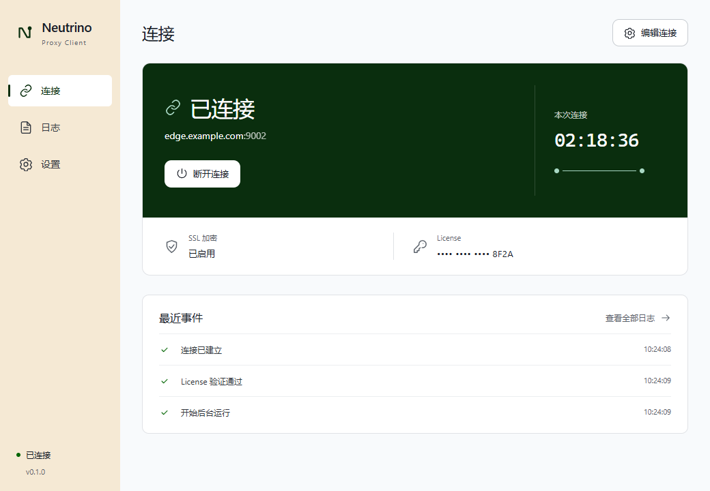
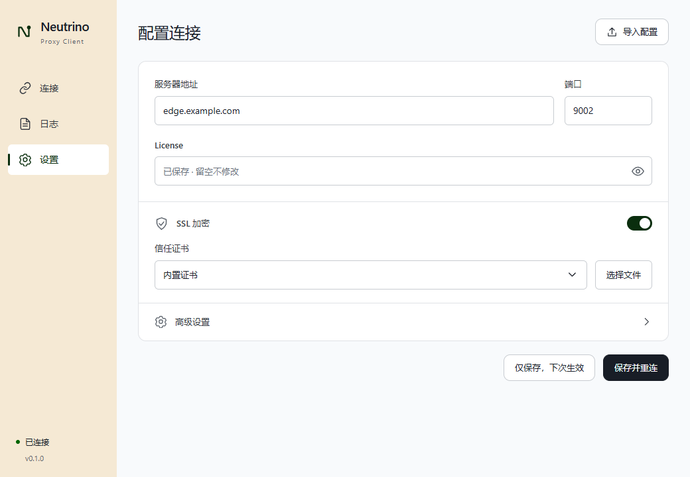
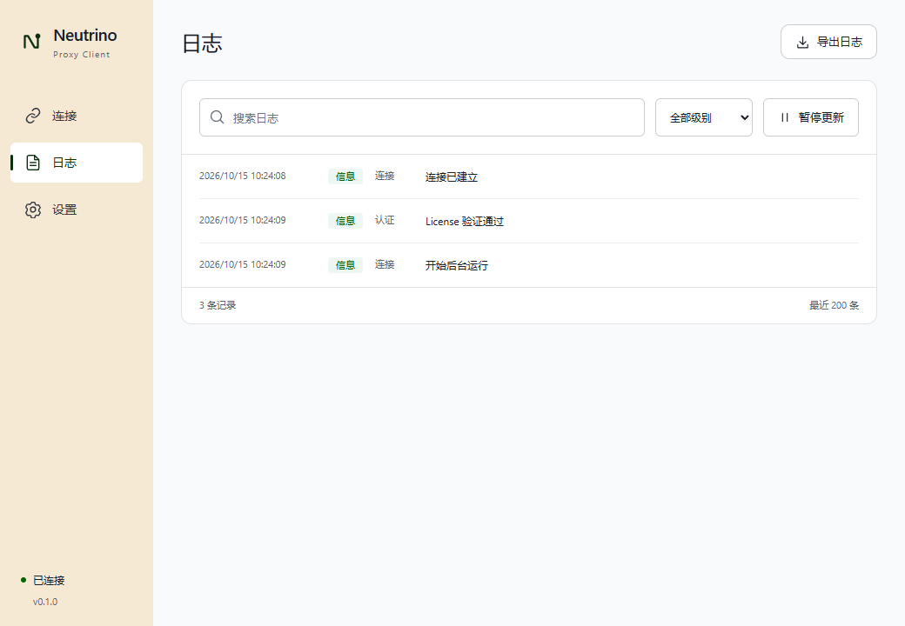

# 桌面客户端界面与交互

状态：Superseded
最后更新：2026-10-15
替代文档：[简约版当前设计](../02-design/client-app-ui.md)；替代原因：用户否决色块方案，并确认新的简约样图。
关联文档：[总体方案](../00-project/client-app-proposal.md)、[架构设计](../03-architecture/client-app-architecture.md)、[验证记录](../06-delivery/client-app-development-status.md)、[初稿归档](../99-archive/client-app-ui-initial.md)

## 本轮范围与依据

用户要求重新设计现有 App，并去掉非必要的说明性文字。本轮覆盖连接、设置、日志三页与公共导航；继续使用用户已选择的 awesome-design-md / VoltAgent/awesome-design-md / airtable 风格。连接协议、配置含义、凭证存储和后台运行逻辑不变。

原先概念样图与界面说明保存在[初稿归档](../99-archive/client-app-ui-initial.md)。当前页面以本文和实际 Vue 实现为准；初稿中的完整迁移目标不能视为已实现。架构与迁移范围继续以架构设计及开发进展为准。

## 视觉系统

采用奶油色导航、浅色工作区、白色表单，以及连接页的深绿状态面板。使用色块、字级与留白建立层次，不使用渐变、背景图片、持续动效或虚构性能图表。

| 角色 | 值 |
|---|---|
| 导航 / 工作区 / 内容 | #f5e9d4 / #f8fafc / #ffffff |
| 主文字 / 正文 / 次级文字 | #181d26 / #333840 / #5b626b |
| 已连接面板 / 点线 | #0a2e0e / #a8d8c4 |
| 连接失败面板 | #aa2d00，白色文字 |
| 主按钮 | #181d26，白色文字 |
| 焦点 / 文字链接 | #458fff / #1b61c9 |
| 输入框 / 内容 / 状态面板圆角 | 6 / 10 / 12 像素 |
| 正文 / 标签 / 页面标题 / 主状态 | 14 / 13 / 24 / 32 像素 |

字体使用 Segoe UI、Microsoft YaHei UI、PingFang SC 和系统字体回退。字重以 400–500 为主；时长采用系统等宽字体。桌面适配保留参考库色彩与控件特征，使用紧凑间距；次级灰色按小字号可读性调整。品牌使用项目自有的 N 字形，不复制参考公司的标识。

默认内容窗口为 1040 × 720，最小 860 × 620。导航为 176 像素，小窗口收至 156 像素；内容边距 24–32 像素，宽窗口内容最大 1080 像素。沿用系统原生标题栏。

## 连接页

- 状态面板集中显示状态、服务器与端口、连接操作和本次连接时长。服务器与端口只展示一次；长地址截断后可通过悬停查看全文。
- 已连接使用深绿色面板；连接中使用深墨色；空配置使用奶油色；失败使用珊瑚色。状态始终同时具有文字，不能只靠颜色区分。
- SSL 与 License 放在面板下方的简洁信息行，凭证始终脱敏。
- 最近事件使用紧凑列表，时间右对齐；没有事件时只显示“暂无事件”。
- 删除常驻的关窗托盘说明、认证成功解释和首次配置教程。
- 首次连接保留“填写连接信息”和“导入配置”。错误和重连显示具体原因；重试倒计时只使用真实时间戳；立即重试、停止重连、取消连接等行为继续可用。
- 已保存但未应用的配置显示“新配置将在下次连接时生效”。服务器与 SSL 摘要始终取当前活动连接的配置，避免误报新配置已经生效。

## 设置页

使用一块连续的白色表单，按地址与凭证、SSL、可折叠高级设置分区。基础字段保持原含义；SSL 关闭时隐藏证书区，选择自定义 JKS 时显示密码字段。

删除副标题、SSL 端口解释、证书教程、高级字段清单及端口映射说明。保留字段标签、示例占位、校验错误、未保存标记和保存结果。已保存 License 的空输入提示为“已保存 · 留空不修改”，提交时仍使用 null 保持原凭证，不把掩码当作 License。

只保存时，活动连接按钮为“仅保存，下次生效”；另一个按钮明确为“保存并重连”。未连接时分别为“仅保存”“保存并连接”。小窗口及展开高级设置后操作区保持可达；默认折叠状态无需多余滚动。

## 日志页

搜索、级别与暂停组成工具栏，导出放在页头。列表以时间、级别、来源与消息排列，较窄窗口隐藏次要来源列。底部只保留记录数与最近 200 条范围；删去教学式副标题和长段导出说明。

暂停只冻结视图，后台仍记录；短状态提示保留这一含义。空筛选提供清除筛选。日志容量、脱敏和导出规则继续沿用现有实现。

## 验证与截图

本轮执行组件测试、Edge 浏览器流程、生产前端构建及 Windows 原生构建。浏览器测试覆盖首次配置、已连接、日志筛选、最小窗口、长地址、SSL 隐藏与高级校验；组件测试另覆盖重连操作和活动配置语义。实际结果见[验证记录](../06-delivery/client-app-development-status.md)。

以下为实际 Vue 页面在浏览器中的运行截图，使用明确的 IPC 测试替身与虚构数据，不代表连接生产服务：

