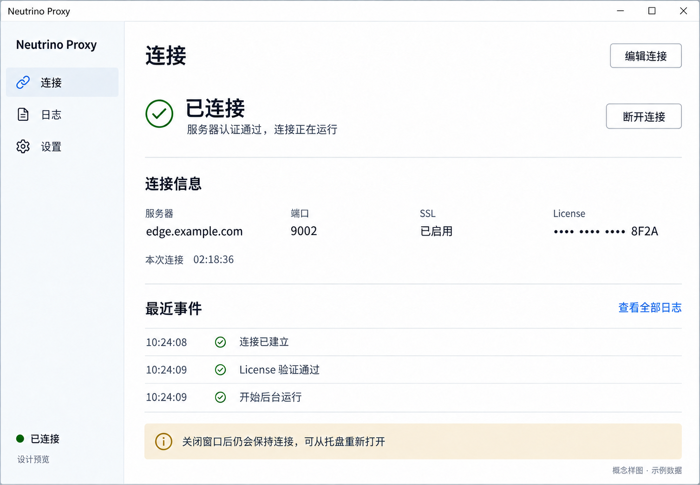
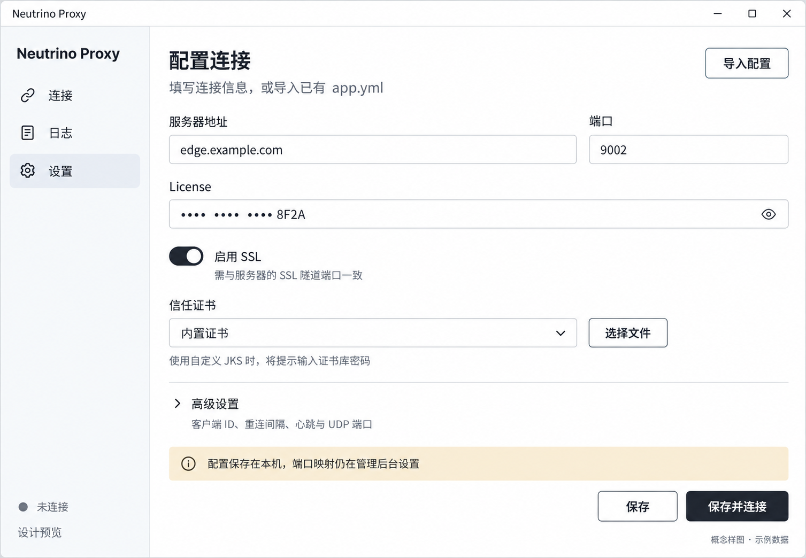

# 桌面客户端界面与交互

状态：Superseded
最后更新：2026-10-15
替代文档：[桌面客户端当前界面](../02-design/client-app-ui.md)；归档原因：用户要求重新设计并删除冗余说明。
关联文档：[总体方案](../00-project/client-app-proposal.md)、[架构设计](../03-architecture/client-app-architecture.md)、[验收方案](../04-quality/client-app-acceptance.md)、[样图生成记录](../02-design/client-app-mockup-prompts.md)

## 1. 布局方向

用户已于 2026-10-15 选择本地 `awesome-design-md` 的 `airtable` 风格，选择结果已记录到根目录 `AGENTS.md`。以下把其白底、深墨色文字、留白和克制按钮适配为桌面连接工具。

建议默认窗口为 1040 × 720 逻辑像素，最小 860 × 620。左侧使用约 176 像素导航，主区域保留 28–32 像素边距。页面只有“连接”“日志”“设置”三个一级入口，底部显示版本和连接状态。Windows / macOS 保留各自的系统窗口控制习惯，避免绘制两套相互冲突的关闭按钮。

以文字状态、表单和操作为中心，不铺设大面积统计图。连接成功时，用户第一眼能看到“已连接”、服务器地址和断开按钮。性能指标未实际采集前不显示延迟、速度、内存或可用性百分比。

### 1.1 视觉规范与桌面适配

| 用途 | 采用值 |
|---|---|
| 主画布 / 导航柔和底色 | `#ffffff` / `#f8fafc` |
| 标题 / 正文 / 次级说明 | `#181d26` / `#333840` / `#41454d` |
| 主按钮 / 按下状态 | `#181d26` / `#0d1218`，白色文字 |
| 细分隔线 / 输入边框 | `#dddddd`；输入焦点使用 `#458fff` 外框 |
| 链接 / 已连接文字 | `#1b61c9` / `#006400`，同时提供文字与图标 |
| 说明区 | 奶油色 `#f5e9d4`，搭配深色文字 |
| 输入框 / 提示区 / 主按钮圆角 | 6 / 10 / 12 像素 |
| 间距 | 以 4 像素为基准，优先使用 8、12、16、24、32 像素 |
| 字号与字重 | 正文 15、标签 16、分区标题 20、页面标题 28、主状态 32；字重 400–500。2026-10-15 实现阶段按样图阅读比例调整字号 |

参考库描述的是营销站，本项目采用其中的色彩、字体层级和控件形态；不搬入 96 像素营销分区、大幅彩色宣传卡、定价按钮或品牌素材。为适配 720 像素高的工具窗口，使用 24–32 像素分区间距和 44 像素高表单控件；中文正文行高提高到约 1.5。使用系统字体回退（Windows 的 Segoe UI / Microsoft YaHei、macOS 的系统字体 / PingFang SC），不捆绑未获得授权的 Haas 字体。

实现阶段优先使用 Microsoft YaHei UI / Microsoft YaHei、PingFang SC，随后回退到 Segoe UI 等系统字体；本机 Chromium 字体检查确认中文使用 Microsoft YaHei UI。小窗口下配置操作区保持在可视范围，表单内容可独立滚动，防止保存按钮被挤出窗口。

已连接页的“断开连接”使用白底描边按钮；配置页只有“保存并连接”使用实心主按钮。导航选中态采用浅底色和深色文字。错误采用参考色板的深珊瑚色 `#aa2d00` 加图标及文字，不能只靠颜色。参考库未定义完整的交互状态，本项目按用户要求补充可见 hover、focus、disabled 和校验状态；这些是桌面可用性适配，不表示修改上游参考。

## 2. 连接页

从上到下排列：页面标题与“编辑连接”入口 → 当前状态和一句解释 → 主要操作 → 连接摘要 → 最近事件。

| 区域 | 内容 | 交互 |
|---|---|---|
| 状态区 | 图标、状态文字、简短原因、状态更新时间 | 不仅依赖颜色；异常原因可展开详细信息 |
| 主操作 | 未连接时“连接”；连接中“取消”；已连接时“断开连接”；重连等待时“立即重试”和“停止重连” | 重复点击不会启动第二个连接实例 |
| 连接摘要 | 服务器、端口、SSL 状态、脱敏 License、当前会话持续时间 | 编辑跳转连接设置；默认不展示完整 License |
| 最近事件 | 最近 5 条认证、断开、重连或目标连接异常 | “查看全部日志”进入日志页 |
| 提示区 | 首次连接后说明“关闭窗口后仍会保持连接，可从托盘重新打开” | 用户读过后不反复打断 |

“已连接”表示认证通过且控制通道健康，不表示所有端口映射的目标服务都可达。连接摘要不渲染管理后台的端口映射列表，以免产生新增管理能力的误解。

首次没有配置时，用简短说明和“填写连接信息”“导入已有配置”两项操作替代空表格；不自动向默认地址发起连接。

## 3. 连接配置表单

基础表单使用单列标签，服务器与端口可并排；必填标记清晰，错误紧邻字段。占位示例使用 `edge.example.com` 等保留示例域名。

| 字段 | 默认与展示 | 校验与反馈 |
|---|---|---|
| 服务器地址 | 域名或 IP，初次为空 | 不接受带路径的 URL；错误提示说明应填主机地址 |
| 端口 | 新配置建议 9002；导入保留原值 | 1–65535；SSL 切换不偷偷改端口 |
| License | 密码式输入；允许临时显示 | 必填；保存后的显示值为掩码，不能把掩码重新当成真实值 |
| 启用 SSL | 新配置默认启用；导入保留原值 | 说明必须与目标隧道端口匹配 |
| 信任证书 | 显示内置证书或导入文件名称 | 选择文件后校验证书格式；密码错误不覆盖已有配置 |
| 证书库密码 | 仅导入加密证书库时要求 | 不显示在预览差异或日志中 |

“高级设置”折叠展示客户端 ID、重连间隔、认证失败后持续重试、心跳与读超时、UDP 端口范围及兼容参数。保留字段说明，避免要求普通用户理解线程池和帧长度。

未连接时底部提供“保存”“保存并连接”；已有连接时提供“保存，下次生效”和“保存并重连”。保存失败保持当前表单及活动连接，显示具体错误；保存成功但尚未生效时显示“当前连接使用旧配置”。

## 4. 导入旧配置

导入步骤：选择 `app.yml` → 解析与校验 → 展示脱敏预览 → 确认保存。

- 预览按“直接兼容”“需要补充”“需确认的运行时参数”分组，标明旧值、拟采用值和原因。
- 支持识别旧环境变量占位形式；缺少值的字段要求在 App 中补全，不把 `${...}` 原样当成服务器或 License。
- 证书路径相对导入文件解析；找不到文件时提供文件选择器。导入仅读取用户选择的配置及明确需要的关联证书。
- 用户可选择导入旧 `.NEUTRINO_PROXY_CLIENT_ID`，或使用配置中已有 ID；新安装才生成新的持久身份。
- 导入不修改或删除旧文件。未知参数保留到兼容信息区，并明确它是否生效；影响协议的未知值阻止连接并解释原因。
- 不在预览中显示凭证明文。导出默认脱敏，便于分享诊断；凭证迁移能力另按安全设计审批。

## 5. 状态与错误文案

| 状态 | 主文案示例 | 可操作项 |
|---|---|---|
| idle | 尚未连接 | 连接、编辑连接 |
| validating | 正在检查连接配置 | 取消 |
| connecting | 正在连接服务器 | 取消 |
| authenticating | 正在验证 License | 取消 |
| connected | 已连接 | 断开连接、编辑连接 |
| reconnecting | 连接已中断，10 秒后重试 | 立即重试、停止重连、查看日志 |
| stopping | 正在断开连接 | 禁用重复操作，仍可查看日志 |
| error / auth | License 验证失败，请检查后重试 | 编辑 License、重试 |
| error / tls | 无法验证服务器证书 | 查看原因、修改证书设置 |
| error / network | 无法连接服务器，请检查地址与网络 | 编辑连接、重试 |

只有确有倒计时事件时才显示数字。按既有 `unlimited` 策略决定认证失败后是否继续重试；默认停止本次引擎会话并保留窗口，方便用户修正信息。错误详情显示可复制的脱敏错误码、阶段和时间，不把调用栈直接塞进主要文案。

## 6. 日志页

顶部为级别筛选、关键词、暂停自动滚动、导出；主体为带时间、级别、来源和消息的日志列表。默认聚焦连接与异常，展开一行查看完整脱敏信息。

暂停自动滚动只停止视图追随，不停止后台记录。空结果区说明“当前筛选没有日志”并提供清除筛选。导出先选择目标文件；记录本地发生的连接事件，不采集业务载荷。

建议视图使用虚拟列表，内存中保留最近 2,000 条且总计不超过 4 MiB，单条显示上限 4 KiB；更早日志从滚动文件按需读取。具体日志规则见架构设计，避免页面与后台重复定义存储策略。

## 7. 设置页与托盘

设置页按“连接配置”“启动与后台”“日志与关于”分组。启动选项分别为“登录系统时启动”和“启动后自动连接”，默认关闭；可从这里打开日志目录和查看版本。首版不加入主题市场、云账号或系统服务安装入口。

托盘 / macOS 菜单栏菜单依次为：当前状态（只读）、打开主窗口、连接或断开、查看日志、退出应用。图标状态由 Rust 更新，窗口不在也能工作。

关闭窗口后销毁界面对象，保留连接；重新打开时按架构文档的快照与事件同步流程恢复当前状态，避免打开窗口期间发生的断线或认证变化被遗漏。未保存的编辑先提示保存或放弃。退出应用取消全部连接与重连；正在传输时提示会中断连接，用户确认退出才关闭进程。系统关机或用户注销遵循系统退出流程，不能用弹窗阻止系统退出。

## 8. 无障碍与视觉验收

表单具有标签、可见焦点和键盘顺序，Enter 提交当前表单但不触发退出或断开；Esc 关闭弹层但不改变后台连接。状态和错误同时使用文字与图标。检查 100%、150%、200% 缩放、长地址、长错误消息和中英文目录名；主要操作始终可见。

两张概念样图已使用内置 `image_gen` 生成，按本文核对主要文字、字段、状态和操作，并修订了主页初稿的中文标题。静态样图检查不替代未来的 UI 实现与平台验收。

## 9. 高保真样图

两张 PNG 均为 1507 × 1044 像素，展示相同的 Airtable 风格桌面外壳。示例使用 Windows 窗口控制；macOS 实现保留相同内容布局，采用系统原生的窗口控制位置。图中“设计预览”代替尚未确定的产品版本号，连接时长和日志时间都是示例值。

### 9.1 已连接主页

用户打开窗口即可看到连接是否成功；连接摘要和最近事件在同一页，“断开连接”与“编辑连接”清楚区分。宽窗口的摘要可以排列为四列，较窄窗口改为两列。底部提示说明关窗后仍在后台工作。

### 9.2 首次连接配置

基础表单展示服务器、端口、License、SSL 和证书。“高级设置”默认折叠；用户可导入旧配置，也可填写后直接保存并连接。图中为用户已输入示例参数的状态，全新安装时服务器与 License 初始为空。

样图和本文为待审阅设计，不是可运行 App 截图。主要布局、控件和语义以本文为准；像素级间距、系统字体及交互状态在后续实现中按视觉规范验证。实际提示词、生成方式和目视检查记录见[样图生成记录](../02-design/client-app-mockup-prompts.md)。

